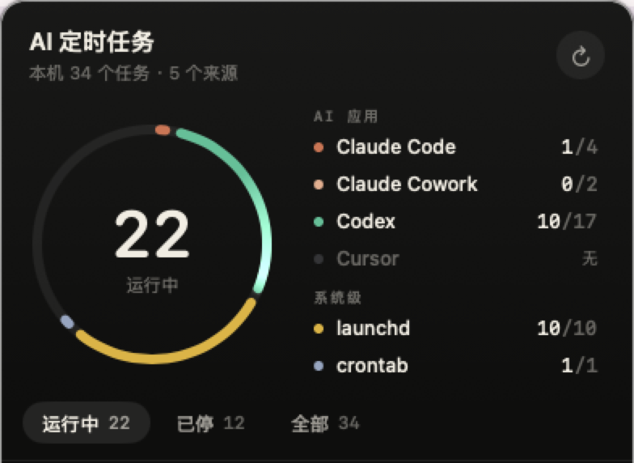

# AI 定时任务（AICronHelper）

macOS 菜单栏小组件：把本机各个 AI 工具里开的定时任务集中显示在一个地方。菜单栏常驻「图标 + 运行中数量」，点开是按来源分段的环形图和任务列表（整圈 = 全部任务，彩色段 = 各来源运行中的数量）。



## 读取哪些来源

| 来源 | 位置 | 说明 |
|---|---|---|
| Claude Code（桌面端定时任务） | `~/Library/Application Support/Claude/claude-code-sessions/*/*/scheduled-tasks.json` | 上次运行取 `lastRunAt` |
| Claude Cowork | `~/Library/Application Support/Claude/local-agent-mode-sessions/*/*/scheduled-tasks.json` | 同上 |
| Codex automations | `~/.codex/automations/*/automation.toml` | 运行记录读 `~/.codex/state_<N>.sqlite`（只读）；心跳类任务显示的是「线程最近活动」 |
| Cursor | — | Cursor 目前没有本机定时任务存储，界面如实显示「无 / 未检测到」 |
| launchd | `~/Library/LaunchAgents`、`/Library/LaunchAgents`、`/Library/LaunchDaemons` | 只收带 `StartCalendarInterval` / `StartInterval` 的 plist，排除 Apple、Google、Homebrew 等厂商项；显示加载状态和上次退出码 |
| crontab | `crontab -l` | 名称取行尾注释，否则取命令的可执行文件名 |

全部只读：不改任何应用的配置，不读取、不显示任务的 prompt 正文，launchd / cron 只显示脚本文件名，不显示完整参数。

## 状态口径

- **运行中**：会按计划继续触发（Claude `enabled`、Codex `ACTIVE`、launchd 已加载）
- **已停**：已暂停 / 未加载，或一次性任务已经跑过（标「已结束」）
- 菜单栏数字 = 所有来源「运行中」的总数

## 构建与安装

```bash
scripts/build.sh
```

产物：`dist/AICronHelper-<版本>.dmg`。打开 DMG，把 `AICronHelper.app` 拖进「应用程序」即可。App 用 ad-hoc 签名、未公证，只适合本机自用；没有开 App Sandbox（需要读 `~/.codex` 和 Claude 的数据目录）。

核对采集结果：

```bash
.build/release/AICronHelper --dump
```

单元测试：

```bash
swift test
```

## 自动更新

用 [Sparkle](https://sparkle-project.org) 实现：面板底部「检查更新」手动检查，后台每天自动检查一次。后台发现新版本时不弹窗，菜单栏图标出现小圆点、面板顶部出现提示，点开后显示更新说明，一键下载、安装并重启。

- 更新源：仓库根目录的 `appcast.xml`（App 从 `raw.githubusercontent.com` 读取），安装包放在 GitHub Release
- 安装包用 EdDSA 签名，App 内置公钥校验，签名不对会拒绝安装
- 签名私钥**不进仓库**，只保存在发布者本机，务必备份：丢失后已安装的 App 无法再收到更新

## 发布新版本

1. 首次发布前，在仓库根目录建 `.release.env`（已在 `.gitignore` 里，不会提交），写入签名私钥路径：`SPARKLE_KEY_FILE=<私钥文件路径>`
2. 写更新说明 `docs/release-notes/<版本>.md`（只写改了什么，会显示在 App 的更新窗口里），提交并推送
3. 运行：

```bash
scripts/release.sh 0.2.1 docs/release-notes/0.2.1.md
```

脚本会检查工作区干净且与 `origin/main` 一致，然后打包、签名、发布 GitHub Release，最后把新版本写进 `appcast.xml` 并推送。

## 目前不做

- 不计算下次触发时间（只显示可读的调度描述）
- 不能在面板里启用 / 暂停任务（各家配置由各自的 App 管理，外部改写有被覆盖的风险）
- 不读取 Claude 云端 Routines（在云端，需要账号 API）
